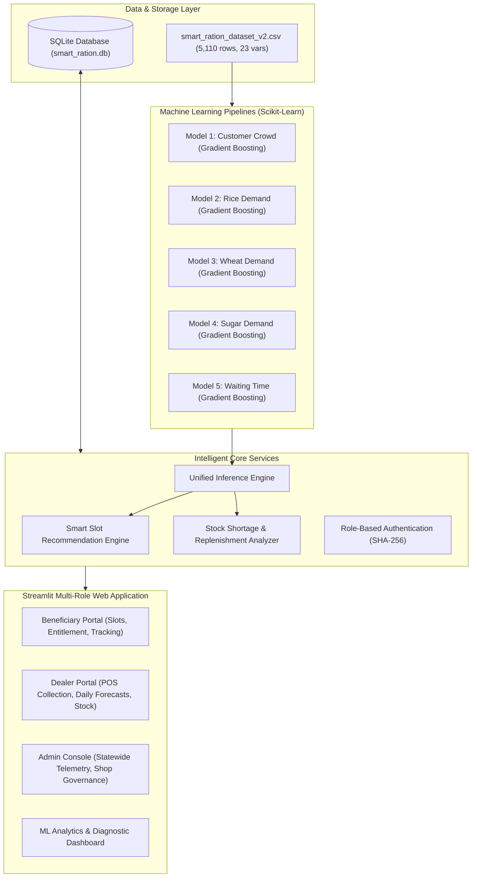

# 🌾 SMART RATION AND DISTRIBUTION SYSTEM (PDS)
### End-to-End Machine Learning Web Application & Operational Decision Engine

---

## 📌 1. Project Overview & Problem Statement

The **Smart Ration and Distribution System** is an intelligent, full-stack machine learning web application engineered to modernize the **Public Distribution System (PDS)**. Traditional ration depots frequently encounter severe bottlenecks:
- Unpredicted customer surges leading to long queues and extended waiting times.
- Imprecise demand estimation causing localized commodity stockouts (Rice, Wheat, Sugar).
- Inefficient customer footfall management without appointment or slot reservations.
- Information asymmetry where citizens travel to fair price shops without knowing real-time inventory.

This application integrates **5 dedicated Scikit-Learn Machine Learning regression pipelines**, an **ACID-compliant SQLite relational database**, a **smart slot recommendation engine**, and an **interactive Streamlit frontend** featuring role-based portals for **Beneficiaries (Citizens)**, **Fair Price Shop Dealers**, and **PDS Administrators**.

> **Academic & Synthetic Data Disclaimer:**
> The underlying dataset (`smart_ration_dataset_v2.csv`) is synthetic academic data generated for machine learning research and educational demonstration. It must not be cited or represented as official government PDS statistics.

---

## 🏗️ 2. System Architecture



---

## 📊 3. Dataset Profile & Feature Engineering

The dataset spans 2 full operational years (**2025-01-01 to 2026-12-31**), totaling **5,110 observations** across 7 daily operating hours:

| Category | Variables Included |
|---|---|
| **Temporal & Operational** | `Date`, `Day`, `Hour`, `Time_Slot`, `Is_Weekend`, `Is_Holiday` |
| **Footfall & Queues** | `Bookings`, `Previous_Crowd`, `Previous_Transactions`, `Customers`, `Waiting_Time_Min` |
| **Capacity & Staffing** | `Staff_On_Duty`, `Counters_Available`, `Registered_Beneficiaries` |
| **Depot Inventory (kg)** | `Rice_Stock_kg`, `Wheat_Stock_kg`, `Sugar_Stock_kg` |
| **Commodity Customers** | `Rice_Customers`, `Wheat_Customers`, `Sugar_Customers` |
| **Commodity Demands (kg)** | `Rice_Demand_kg`, `Wheat_Demand_kg`, `Sugar_Demand_kg` |

### Anti-Leakage & Chronological Holdout Strategy
- **Chronological Split**: An **80/20 chronological train/test split** was strictly enforced (`4,088` train rows from `2025-01-01` to `2026-08-07`; `1,022` test rows from `2026-08-08` to `2026-12-31`). No random shuffling was allowed across time series records.
- **Leakage Prevention Audit**: Target variables (such as actual customers or future waiting times) were strictly excluded from pre-slot feature sets. Only operational features realistically available before the slot begins (`Bookings`, `Previous_Crowd`, `Staff_On_Duty`, etc.) are utilized.

---

## 🤖 4. Machine Learning Model Evaluation & Results

Four candidate regression algorithms were trained, cross-validated via `TimeSeriesSplit`, and evaluated across each of the 5 prediction tasks:
1. **Linear Regression**
2. **Random Forest Regressor**
3. **Extra Trees Regressor**
4. **Gradient Boosting Regressor**

### Official Test Split Performance Comparison Table

| Target Task | Selected Best Algorithm | Test R² Score | Test RMSE | Test MAE | CV R² Score | Generalization Gap |
|---|---|---|---|---|---|---|
| **Customer Crowd** (`Customers`) | **Gradient Boosting** | **0.8947** | **5.225** | **4.173** | 0.8779 | 0.0528 |
| **Rice Demand** (`Rice_Demand_kg`) | **Gradient Boosting** | **0.8195** | **25.806 kg** | **20.303 kg** | 0.7927 | 0.0632 |
| **Wheat Demand** (`Wheat_Demand_kg`) | **Gradient Boosting** | **0.7444** | **13.097 kg** | **10.326 kg** | 0.7372 | 0.0766 |
| **Sugar Demand** (`Sugar_Demand_kg`) | **Gradient Boosting** | **0.7371** | **4.628 kg** | **3.623 kg** | 0.7087 | 0.0785 |
| **Waiting Time** (`Waiting_Time_Min`) | **Gradient Boosting** | **0.6588** | **2.378 min** | **1.923 min** | 0.5966 | 0.0743 |

All 5 top-performing models are serialized as Joblib pipelines in the `models/` directory.

---

## 💡 5. Core Intelligent Engines

### A. Smart Slot Recommendation Engine (`services/recommendation_service.py`)
- Evaluates all available time slots (`9-10 AM`, `10-11 AM`, `11-12 PM`, `12-1 PM`, `4-5 PM`, `5-6 PM`, `6-7 PM`).
- Predicts expected customer volume and waiting times per slot using the trained ML models.
- Checks live booked capacity against dealer-configured maximum limits.
- Automatically tags slots:
  - 🟢 **Best**: Wait time ≤ 7 min & low customer crowd.
  - 🔵 **Recommended**: Wait time ≤ 11 min.
  - 🟡 **Moderate**: Wait time ≤ 16 min.
  - 🔴 **Busy**: Wait time > 16 min.
  - ⛔ **Full / Closed**: Booking capacity reached or slot sealed by administrator.

### B. Stock Shortage Prediction & Replenishment Analyzer (`services/stock_service.py`)
- Aggregates daily predicted demand across all operational hours.
- Compares available depot inventory with projected consumption.
- Generates categorized alerts:
  - **CRITICAL SHORTAGE**: Forecasted demand exceeds on-hand stock.
  - **LOW STOCK WARNING**: Projected closing stock falls below the mandated buffer threshold.
  - **ADEQUATE**: Sufficient stock to cover demand and retain safety buffer.
- Computes exact recommended replenishment quantities to prevent supply disruptions.

---

## 📱 6. User Portals & Features

The application features **dedicated role-based login gateways** on the home portal, each tailored with distinct authentication, visual branding, and 1-click demo access:

### 1. Citizen & Beneficiary Portal (`citizen1` / `citizenpassword`)
- **Statutory Entitlement & Live Depot Stock**: Visual cards showing authorized rice, wheat, and sugar allowances, with live availability badges at their assigned fair price depot.
- **Smart Time-Slot Booking**: Machine Learning queue optimizer scoring operational slots with color-coded tags (`Best`, `Recommended`, `Moderate`, `Busy`).
- **Electronic Booking Slips**: View and manage active reservations with unique booking references (`BK-...`).
- **Digital Collection Vouchers & Receipts**: Official electronic receipts complete with QR/security hash, itemized subsidies, and fair price shop details.
- **Simulated SMS / Push Notification Inbox**: Timestamped PDS notification logs simulating real-time SMS alerts for bookings and distributions.
- **Online Cardholder Self-Registration**: New citizens can apply for and activate a digital ration card directly from the landing page.
- **Grievance Filing**: Direct grievance submission to the Taluk Food Inspector.

### 2. Fair Price Shop Dealer Portal (`dealer1` / `dealerpassword`)
- **Operations & Live Booking Roster**: Real-time overview of active staff, manned distribution counters, and booked beneficiaries for the day.
- **Daily Demand Forecast & Shortage Detection**: Gradient Boosting multi-commodity demand projections compared against current inventory, generating automated low-stock warnings and replenishment calculations.
- **Biometric POS Disbursement (Checkout)**: Verification via Ration Card number or Booking Reference, one-click disbursement, automated stock deduction, and immediate generation of digital receipts.
- **Depot Delivery Inflow Logging**: Record incoming grain shipments from Central Warehousing Corporation with delivery challans.
- **Data Export Suite**: One-click CSV export for daily POS transactions and inventory status.

### 3. PDS Administrative Directorate (`admin` / `adminpassword`)
- **Statewide Multi-Depot Surveillance**: High-level command center monitoring total fair price shops, registered cardholders, and overall grain distribution with CSV export.
- **Fair Price Shops & Beneficiary Registries**: Searchable statewide directories of shops and cardholders across card tiers (`AAY`, `PHH`, `NPHH`).
- **Slot Capacity Governance**: Real-time adjustment of allowable bookings per slot/shop to prevent overcrowding.
- **Citizen Grievance Redressal**: Inspection of lodged complaints with inspector resolution notes.
- **ML Telemetry & Auditing**: Live audit trail of all machine learning inference requests.

### 4. Real-Time Communication & Notification Engine (Email & SMS)
- **Automated Booking Confirmation Emails**: Dispatches formal HTML appointment tokens with shop name, slot window, and predicted queue wait times.
- **Official Digital Collection Receipts**: Dispatches verified e-Invoices with NFSA security hashes, subsidized commodity breakdown, and total amounts paid upon dealer POS disbursement.
- **Telecom SMS Dispatching**: Dispatches concise SMS alerts for slot tokens, emergency updates, and collection confirmations.
- **Dual Gateway Architecture**:
  - **Live SMTP Network Mode**: Connects securely via TLS (e.g. Gmail / Outlook with App Password) for true inbox delivery across the internet.
  - **Local Sandbox Mode**: Captures and logs all dispatches into SQLite notifications without requiring external mail servers.
- **Interactive In-App Testing Sandbox**: Built-in test console in the Beneficiary portal allowing users to dispatch sample alerts to any email or mobile number on demand.
- **Statewide Admin Broadcast Center**: Food Directorate can broadcast emergency stock announcements or festive ration alerts to all cardholders across the state with one click.

### 5. Data Science & ML Analytics Studio (Public / Guest Explorer Mode)
- **Model Comparison Dashboard**: Comprehensive test split benchmarks ($R^2$, RMSE, MAE, CV $R^2$, Overfitting Gap) across all 4 candidate regression algorithms.
- **Diagnostic Validation Plots**: High-resolution Actual vs. Predicted scatter plots and Residual distribution diagnostics.
- **Real-Time What-If Scenario Simulator**: Interactive sliders for hour, bookings, prior footfall, staff, and counters to test live multi-model predictions.
- **Exploratory Data Analysis (EDA) Gallery**: 8 publication-grade charts illustrating footfall distributions, correlation heatmaps, and queue patterns.

### 6. Multilingual Interface Support
- Seamless one-click language toggle in the header supporting **English**, **ಕನ್ನಡ (Kannada)**, and **हिंदी (Hindi)**.

---

## 🚀 7. Installation and Running the Application

### Prerequisites
- Windows 10 or 11
- Python 3.10+ (Verified on Python 3.14)

### Step 1: Install Dependencies
```bash
pip install -r requirements.txt
```

### Step 2: Seed the Database
```bash
python database/seed.py
```

### Step 3: Train & Evaluate Models (Optional - Models already pre-trained)
```bash
python ml/train_models.py
```

### Step 4: Launch the Streamlit Web Application
You can run the application directly using any of the following:

**Option A (Recommended via Python module):**
```bash
python -m streamlit run app.py
```

**Option B (Direct execution — auto-redirects to Streamlit):**
```bash
python app.py
```

**Option C (Double-click launcher on Windows):**
Double-click `run_app.bat` or run `.\run_app.ps1`.

Open your browser at `http://localhost:8501`.

---

## 🔑 8. Demo User Credentials

| Portal | Username | Password | Role Description |
|---|---|---|---|
| **Beneficiary** | `citizen1` | `citizenpassword` | AAY Cardholder (`RC-KA-99201`), Jayanagar Depot |
| **Beneficiary** | `citizen2` | `citizenpassword` | PHH Cardholder (`RC-KA-88412`), Jayanagar Depot |
| **Dealer** | `dealer1` | `dealerpassword` | Fair Price Shop Dealer #42 (Jayanagar) |
| **Dealer** | `dealer2` | `dealerpassword` | Civil Supplies Center #18 (Malleswaram) |
| **Administrator**| `admin` | `adminpassword` | State PDS Director & System Administrator |

---

## 🧪 9. Automated Testing (Pytest)

The system includes an 18-test unit and integration test suite covering database transactions, password security, model serialization, inference integrity, service workflows, and notification dispatch:

```bash
python -m pytest -v
```

**Test Suite Coverage:**
- `tests/test_database.py`: Password hashing, user creation, atomic slot capacity constraints, and transactional stock deductions.
- `tests/test_models.py`: Model file presence, pipeline deserialization, and R² benchmark validations (>0.50).
- `tests/test_predictions.py`: Output validity, range bounds, and extreme surge scenario tests.
- `tests/test_services.py`: Recommendation engine slot tagging, stock shortage alert evaluations, and email/SMS notification dispatches.

**Result**: `18 passed in 9.10s (100% pass rate)`.

